# 大学生心理健康测评管理系统小程序pf

> 🎓 **计算机毕业设计 · 大学生心理健康测评管理系统小程序pf**
>
> 本仓库只放**项目介绍 + 运行截图**（截图是站点带水印的原图，存在仓库 `images/` 里）。
>
> 👉 **完整可运行源码 / 数据库脚本 / 部署文档：[点我获取](https://geekcode.top/archives/%E5%A4%A7%E5%AD%A6%E7%94%9F%E5%BF%83%E7%90%86%E5%81%A5%E5%BA%B7%E6%B5%8B%E8%AF%84%E7%AE%A1%E7%90%86%E7%B3%BB%E7%BB%9F%E5%B0%8F%E7%A8%8B%E5%BA%8Fpf?utm_source=github)**
>
> 💬 咨询微信：**ir9372**　|　🌐 更多项目：[极客代码 geekcode.top](https://geekcode.top/?utm_source=github)
>
> 📌 项目详情页：<https://geekcode.top/archives/%E5%A4%A7%E5%AD%A6%E7%94%9F%E5%BF%83%E7%90%86%E5%81%A5%E5%BA%B7%E6%B5%8B%E8%AF%84%E7%AE%A1%E7%90%86%E7%B3%BB%E7%BB%9F%E5%B0%8F%E7%A8%8B%E5%BA%8Fpf?utm_source=github>

<table><td width="230" align="center"> <b>扫码加微信 ir9372</b></td><td valign="middle">📦 源码 = 项目介绍 + 全部运行截图 + 数据库 + 部署文档 👉 点上方任意截图，直接跳到 <b>极客代码 geekcode.top</b> 详情页</td></table>

---

<h1>大学生心理健康测评管理系统小程序pf</h1>
<h2>项目概述</h2>

本项目名为“大学生心理健康测评管理系统小程序pf”，旨在为高校学生提供便捷的心理健康自测与咨询服务，同时为学校管理人员提供高效的后台数据管理工具。系统采用微信小程序作为用户端入口，Java Spring Boot 构建后端服务，通过 REST API 实现前后端交互。核心功能涵盖在线心理试卷测评、考试记录查询、心理健康知识浏览、咨询师预约及留言互动等。适用人群主要为在校大学生（用户端）和学校心理健康教育中心管理员（后台端）。技术架构上，后端基于 Spring Boot、MyBatis-Plus 和 Shiro 框架，确保系统的安全性与开发效率；前端使用微信小程序原生或集成 Vue 技术栈，提升用户体验。该项目致力于解决传统线下心理测评流程繁琐、数据分散的问题，实现心理健康管理的数字化与智能化。

<h2>技术架构</h2>

本系统采用经典的前后端分离架构设计，由微信小程序前端、Java 后端服务及 MySQL 数据库组成。

<strong>1. 后端架构</strong>
后端基于 Spring Boot 框架搭建，利用其自动配置特性简化开发流程。持久层采用 MyBatis-Plus，在保留 MyBatis 灵活性的基础上提供了强大的 CRUD 封装，提高数据库操作效率。安全认证模块集成 Apache Shiro，负责用户身份验证、会话管理及权限控制，保障系统数据安全。视图层虽引入 Thymeleaf，但主要服务于后台管理页面的渲染或静态资源处理，核心业务逻辑通过 Controller 层以 JSON 格式响应。

<strong>2. 前端架构</strong>
用户端采用微信小程序技术栈，利用微信生态的便捷性实现免安装、即用即走的体验。小程序通过 HTTP 请求调用后端提供的 RESTful API 接口进行数据交互。虽然项目标记为 vue-integrated，但在小程序环境中主要体现为组件化开发模式，确保界面逻辑清晰且易于维护。

<strong>3. 数据库设计要点</strong>
数据库选用 MySQL，存储用户信息、试卷题库、考试记录、心理健康文章、咨询师信息及论坛帖子等核心数据。设计上遵循规范化原则，通过外键关联实现表间关系（如试题与试卷、用户与考试记录），并利用索引优化高频查询性能。

<strong>4. 交互方式</strong>
前后端通过标准的 REST API 通信。小程序发起 GET/POST/PUT/DELETE 请求，后端 Controller 接收参数，经 Service 层处理后返回统一格式的 JSON 数据。Shiro 拦截器对敏感接口进行权限校验，未授权访问将被拒绝。

<a href="https://geekcode.top/archives/%E5%A4%A7%E5%AD%A6%E7%94%9F%E5%BF%83%E7%90%86%E5%81%A5%E5%BA%B7%E6%B5%8B%E8%AF%84%E7%AE%A1%E7%90%86%E7%B3%BB%E7%BB%9F%E5%B0%8F%E7%A8%8B%E5%BA%8Fpf?utm_source=github" title="查看完整源码">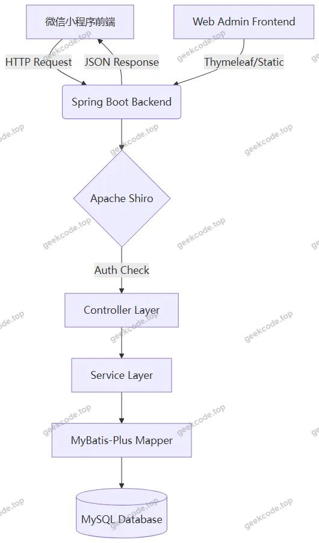</a>

<h2>功能模块</h2>

根据代码上下文中的 Controller 列表、后台路由及小程序截图功能，系统功能划分为以下两大模块：

<h3>1. 小程序用户端功能</h3>

小程序面向普通用户（主要是学生），提供自助式心理健康服务。

<ul>
<li><strong>用户账户体系</strong>：</li>
<li><strong>登录/注册</strong>：支持新用户注册及现有用户登录。</li>
<li><strong>个人中心</strong>：包含个人信息修改、忘记密码、修改密码等功能。</li>
<li><strong>心理健康测评</strong>：</li>
<li><strong>在线评测表</strong>：展示可进行的心理测试试卷列表。</li>
<li><strong>试卷答题</strong>：进入具体试卷进行题目作答。</li>
<li><strong>考试记录</strong>：查看历史测评结果及详细得分情况。</li>
<li><strong>心理健康资讯与服务</strong>：</li>
<li><strong>心理健康文章</strong>：浏览心理健康相关知识普及内容。</li>
<li><strong>收藏与留言</strong>：支持对心理健康文章的收藏以及发表评论/留言。</li>
<li><strong>通知公告</strong>：查看学校发布的最新通知与公告。</li>
<li><strong>心理咨询服务</strong>：</li>
<li><strong>咨询师列表</strong>：浏览可用的心理咨询师信息。</li>
<li><strong>咨询预约</strong>：向指定咨询师发起预约申请。</li>
<li><strong>聊天/互动</strong>：可能包含简单的即时通讯或咨询记录查看功能（基于 <code>zhixunshiChat</code> 路由推断）。</li>
<li><strong>社区交流</strong>：</li>
<li><strong>论坛/留言板</strong>：参与心理健康相关的讨论或留言互动（基于 <code>forum</code> 路由推断）。</li>
</ul>
<h3>2. Web 后台管理端功能</h3>

后台面向管理员，提供全面的数据管理与配置功能。

<ul>
<li><strong>系统配置与管理</strong>：</li>
<li><strong>管理员登录</strong>：后台入口身份验证。</li>
<li><strong>配置文件管理</strong>：修改系统基础配置项。</li>
<li><strong>字典管理</strong>：维护系统下拉选项、状态码等基础数据（如性别、新闻分类、试卷类型等）。</li>
<li><strong>用户与角色管理</strong>：</li>
<li><strong>用户管理</strong>：查看、编辑、删除注册用户信息（<code>yonghu</code>）。</li>
<li><strong>咨询师管理</strong>：维护咨询师档案及状态（<code>zhixunshi</code>）。</li>
<li><strong>测评内容管理</strong>：</li>
<li><strong>试卷管理</strong>：创建、编辑、发布心理测评试卷（<code>exampaper</code>）。</li>
<li><strong>试题管理</strong>：维护具体的心理测试题目库（<code>examquestion</code>）。</li>
<li><strong>试卷选题</strong>：将试题关联至特定试卷，组卷管理（<code>exampapertopic</code>）。</li>
<li><strong>考试记录管理</strong>：查看所有用户的测评提交记录及详情（<code>examrecord</code>, <code>examredetails</code>）。</li>
<li><strong>内容与资讯管理</strong>：</li>
<li><strong>新闻/公告管理</strong>：发布和管理心理健康资讯及校园通知（<code>news</code>）。</li>
<li><strong>心理健康资料管理</strong>：维护心理健康知识库文章（<code>xinlijiankang</code>）。</li>
<li><strong>互动管理</strong>：审核或删除用户留言、收藏记录及论坛帖子（<code>xinlijiankangLiuyan</code>, <code>xinlijiankangCollection</code>, <code>forum</code>）。</li>
<li><strong>咨询互动管理</strong>：监控咨询师与用户的聊天记录或预约状态（<code>zhixunshiChat</code>, <code>zhixunshiYuyue</code>）。</li>
</ul>
<h2>用户角色与权限</h2>

系统主要存在两类角色，权限范围严格隔离：

<h3>1. 普通用户（小程序端）</h3>
<ul>
<li><strong>身份定义</strong>：注册并通过审核的大学生群体。</li>
<li><strong>权限范围</strong>：</li>
<li><strong>自我服务</strong>：仅能查看和操作与自己相关的数据，如自己的个人信息、自己的考试记录、自己发出的咨询预约和留言。</li>
<li><strong>内容消费</strong>：浏览公开的心理健康文章、通知公告、咨询师列表及公开论坛内容。</li>
<li><strong>受限操作</strong>：无法访问后台管理页面，无法修改系统配置，无法查看其他用户的隐私数据（如他人的完整考试详情，除非有特定的分享机制，但通常默认私有）。</li>
</ul>
<h3>2. 管理员（Web 后台端）</h3>
<ul>
<li><strong>身份定义</strong>：学校心理健康教育中心的专职工作人员或系统运维人员。</li>
<li><strong>权限范围</strong>：</li>
<li><strong>全局数据管理</strong>：拥有对所有用户、试卷、试题、文章、评论、预约记录的增删改查权限。</li>
<li><strong>系统配置</strong>：可以修改系统参数、字典数据，管理咨询师账号状态。</li>
<li><strong>审核与监控</strong>：有权审核用户提交的敏感内容（如论坛帖子、留言），查看全系统的考试数据统计。</li>
<li><strong>无前台干扰</strong>：管理员主要通过 Web 浏览器访问后台，不参与小程序端的日常测评活动。</li>
</ul>
<h2>项目特色与创新点</h2>
<ol>
<li>
<strong>移动端优先的心理健康干预</strong>：
   区别于传统的 PC 端心理测评系统，本项目主打微信小程序，充分利用移动设备的便携性。学生可以在任何时间、任何地点进行心理自测，降低了求助门槛，提高了心理筛查的覆盖率和及时性。

</li>
<li>
<strong>闭环式心理服务体系</strong>：
   系统不仅仅提供单一的“做题”功能，而是构建了“知识学习（文章/公告） -&gt; 自我评估（在线测评） -&gt; 问题发现（记录分析） -&gt; 专业干预（咨询师预约/留言）”的完整闭环。这种设计更符合实际心理健康工作的流程需求。

</li>
<li>
<strong>灵活的内容管理架构</strong>：
   后端设计了独立的“试卷-试题-选题”三层结构，允许管理员动态组合不同的心理量表。同时，通过“字典管理”模块，实现了业务枚举值（如健康状况、性别、新闻类型）的可配置化，增强了系统对不同类型心理测评需求的适应能力。

</li>
<li>
<strong>安全与性能兼顾的技术选型</strong>：
   采用 Shiro 进行细粒度的权限控制，确保学生隐私数据（特别是心理测试结果）的安全性。MyBatis-Plus 的使用减少了大量样板代码，提升了开发效率，同时配合 MySQL 索引优化，保证了在高并发访问下（如全校集中测评期间）系统的响应速度。

</li>
</ol>
<h2>部署环境</h2>

为确保项目正常运行，需准备以下软硬件环境：

<strong>1. 硬件环境建议</strong>

<ul>
<li>CPU: 双核及以上处理器</li>
<li>内存: 4GB RAM 及以上（推荐 8GB）</li>
<li>硬盘: 至少 10GB 可用空间</li>
</ul>

<strong>2. 软件环境要求</strong>

<ul>
<li><strong>操作系统</strong>: Windows 10/11, macOS, 或 Linux (CentOS/Ubuntu)</li>
<li><strong>JDK</strong>: Java Development Kit 1.8 或更高版本（Spring Boot 兼容性良好）</li>
<li><strong>数据库</strong>: MySQL 5.7 或 MySQL 8.0</li>
<li><strong>Maven</strong>: Apache Maven 3.6+ （用于后端依赖管理和打包）</li>
<li><strong>Node.js</strong>: LTS 版本（若前端涉及 npm 包管理或构建工具）</li>
<li><strong>IDE</strong>: IntelliJ IDEA 或 Eclipse（后端开发），Visual Studio Code（前端开发）</li>
<li><strong>客户端工具</strong>: 微信开发者工具（用于运行和调试小程序前端）</li>
</ul>

<strong>3. 关键配置文件说明</strong>

<ul>
<li><code>application.yml</code>: 需配置 MySQL 数据库连接地址、用户名、密码，以及文件上传路径等。</li>
<li><code>project.config.json</code>: 小程序配置文件，需填写正确的 AppID（测试号或正式号）。</li>
</ul>
<h2>五、技术特性</h2>
<ul>
<li>前后端集成部署，前端资源打包至后端 static 目录</li>
<li>使用 MyBatis-Plus 简化数据访问层开发</li>
<li>集成 Shiro 权限框架实现角色权限控制</li>
</ul>
<h2>六、功能模块截图</h2>
<h3>微信小程序用户端</h3>

<figure><figcaption>小程序-登录</figcaption></figure>
<figure><figcaption>小程序-个人信息userinfo</figcaption></figure>
<figure><figcaption>小程序-考试记录列表</figcaption></figure>
<figure><figcaption>小程序-试卷exam</figcaption></figure>
<figure><a href="https://geekcode.top/archives/%E5%A4%A7%E5%AD%A6%E7%94%9F%E5%BF%83%E7%90%86%E5%81%A5%E5%BA%B7%E6%B5%8B%E8%AF%84%E7%AE%A1%E7%90%86%E7%B3%BB%E7%BB%9F%E5%B0%8F%E7%A8%8B%E5%BA%8Fpf?utm_source=github" title="查看完整源码">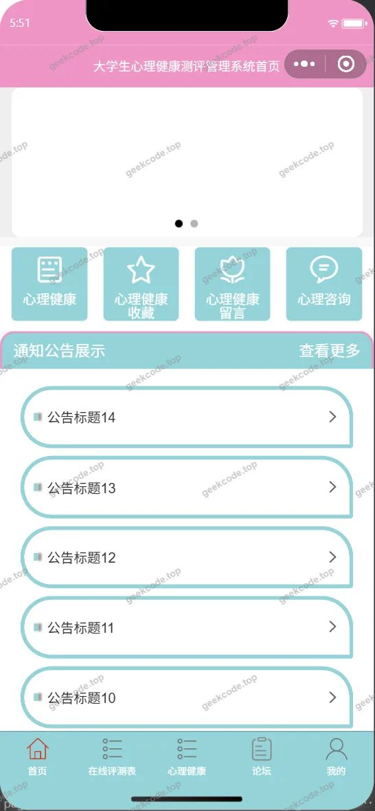</a><figcaption>小程序-首页</figcaption></figure>
<figure><figcaption>小程序-通知公告列表</figcaption></figure>
<figure><figcaption>小程序-忘记密码</figcaption></figure>
<figure><a href="https://geekcode.top/archives/%E5%A4%A7%E5%AD%A6%E7%94%9F%E5%BF%83%E7%90%86%E5%81%A5%E5%BA%B7%E6%B5%8B%E8%AF%84%E7%AE%A1%E7%90%86%E7%B3%BB%E7%BB%9F%E5%B0%8F%E7%A8%8B%E5%BA%8Fpf?utm_source=github" title="查看完整源码">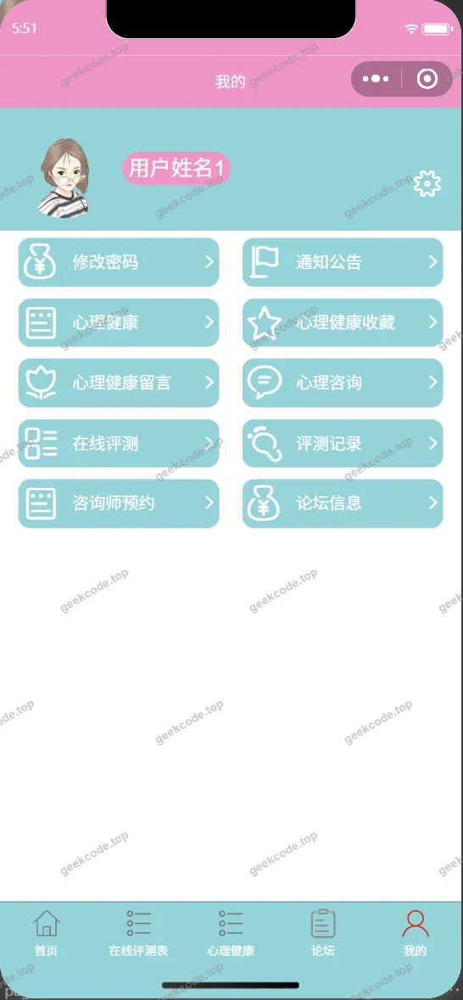</a><figcaption>小程序-我的</figcaption></figure>
<figure><a href="https://geekcode.top/archives/%E5%A4%A7%E5%AD%A6%E7%94%9F%E5%BF%83%E7%90%86%E5%81%A5%E5%BA%B7%E6%B5%8B%E8%AF%84%E7%AE%A1%E7%90%86%E7%B3%BB%E7%BB%9F%E5%B0%8F%E7%A8%8B%E5%BA%8Fpf?utm_source=github" title="查看完整源码">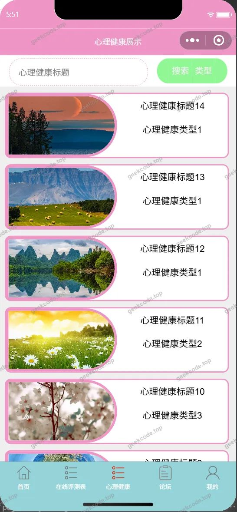</a><figcaption>小程序-心理健康</figcaption></figure>
<figure><figcaption>小程序-心理健康留言列表</figcaption></figure>
<figure><figcaption>小程序-心理健康收藏列表</figcaption></figure>
<figure><figcaption>小程序-心理咨询列表</figcaption></figure>
<figure><a href="https://geekcode.top/archives/%E5%A4%A7%E5%AD%A6%E7%94%9F%E5%BF%83%E7%90%86%E5%81%A5%E5%BA%B7%E6%B5%8B%E8%AF%84%E7%AE%A1%E7%90%86%E7%B3%BB%E7%BB%9F%E5%B0%8F%E7%A8%8B%E5%BA%8Fpf?utm_source=github" title="查看完整源码">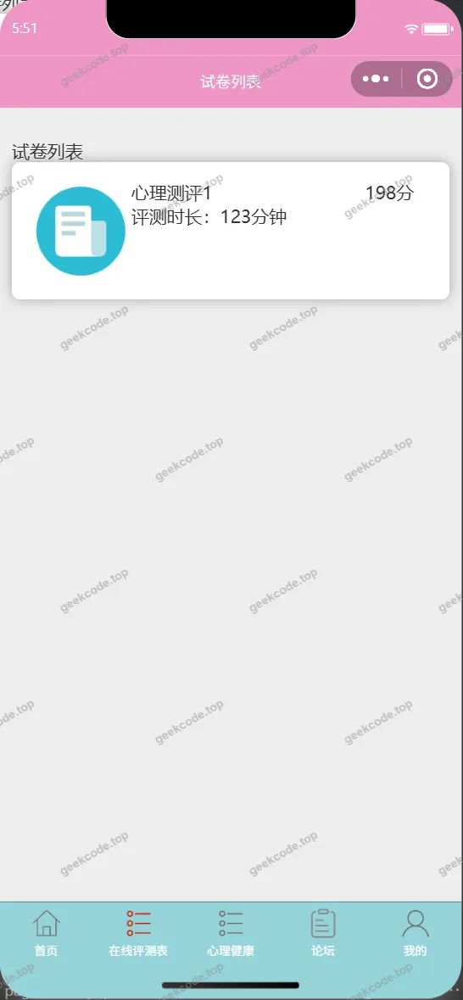</a><figcaption>小程序-在线评测表</figcaption></figure>
<figure><figcaption>小程序-注册</figcaption></figure>
<figure><a href="https://geekcode.top/archives/%E5%A4%A7%E5%AD%A6%E7%94%9F%E5%BF%83%E7%90%86%E5%81%A5%E5%BA%B7%E6%B5%8B%E8%AF%84%E7%AE%A1%E7%90%86%E7%B3%BB%E7%BB%9F%E5%B0%8F%E7%A8%8B%E5%BA%8Fpf?utm_source=github" title="查看完整源码">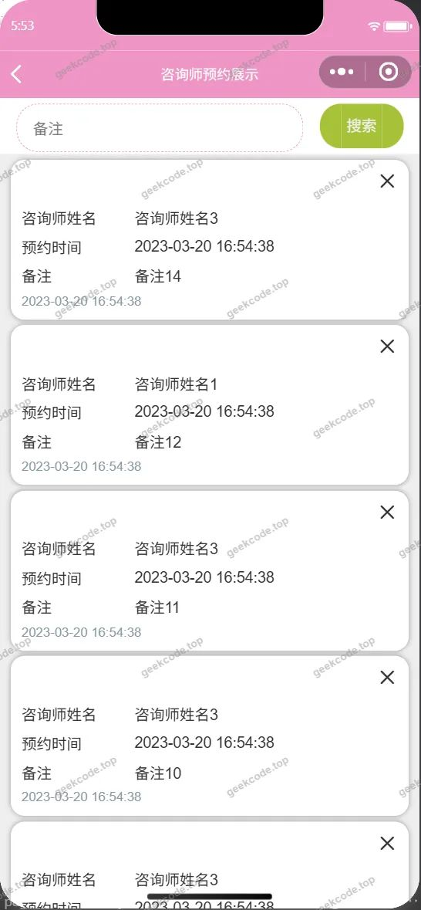</a><figcaption>小程序-咨询师预约列表</figcaption></figure>
<figure><figcaption>小程序-changepassword</figcaption></figure>

<h3>后台管理端</h3>
<h4>后台-登录页</h4>

<h4>后台-管理员</h4>

<a href="https://geekcode.top/archives/%E5%A4%A7%E5%AD%A6%E7%94%9F%E5%BF%83%E7%90%86%E5%81%A5%E5%BA%B7%E6%B5%8B%E8%AF%84%E7%AE%A1%E7%90%86%E7%B3%BB%E7%BB%9F%E5%B0%8F%E7%A8%8B%E5%BA%8Fpf?utm_source=github" title="查看完整源码">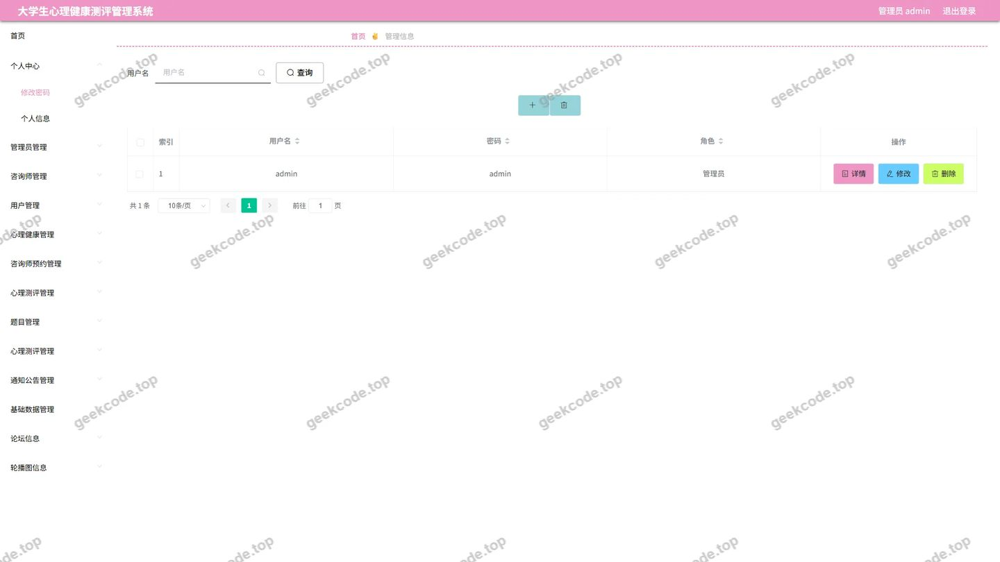</a>

<h4>后台-考试记录</h4>

<a href="https://geekcode.top/archives/%E5%A4%A7%E5%AD%A6%E7%94%9F%E5%BF%83%E7%90%86%E5%81%A5%E5%BA%B7%E6%B5%8B%E8%AF%84%E7%AE%A1%E7%90%86%E7%B3%BB%E7%BB%9F%E5%B0%8F%E7%A8%8B%E5%BA%8Fpf?utm_source=github" title="查看完整源码">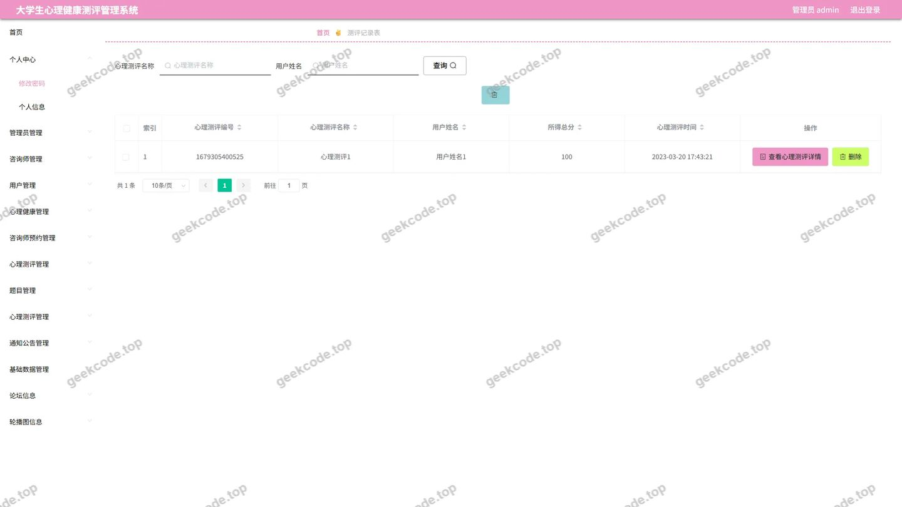</a>

<h4>后台-配置文件</h4>

<a href="https://geekcode.top/archives/%E5%A4%A7%E5%AD%A6%E7%94%9F%E5%BF%83%E7%90%86%E5%81%A5%E5%BA%B7%E6%B5%8B%E8%AF%84%E7%AE%A1%E7%90%86%E7%B3%BB%E7%BB%9F%E5%B0%8F%E7%A8%8B%E5%BA%8Fpf?utm_source=github" title="查看完整源码">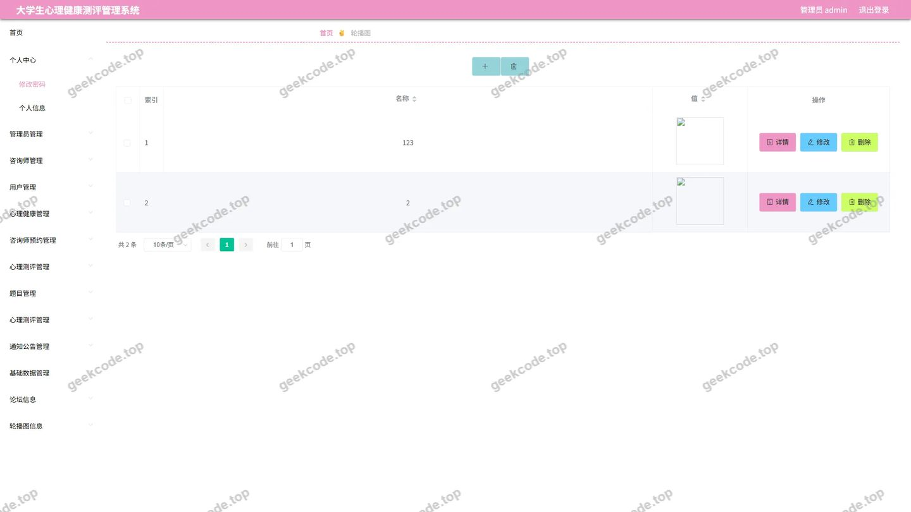</a>

<h4>后台-试卷</h4>

<a href="https://geekcode.top/archives/%E5%A4%A7%E5%AD%A6%E7%94%9F%E5%BF%83%E7%90%86%E5%81%A5%E5%BA%B7%E6%B5%8B%E8%AF%84%E7%AE%A1%E7%90%86%E7%B3%BB%E7%BB%9F%E5%B0%8F%E7%A8%8B%E5%BA%8Fpf?utm_source=github" title="查看完整源码">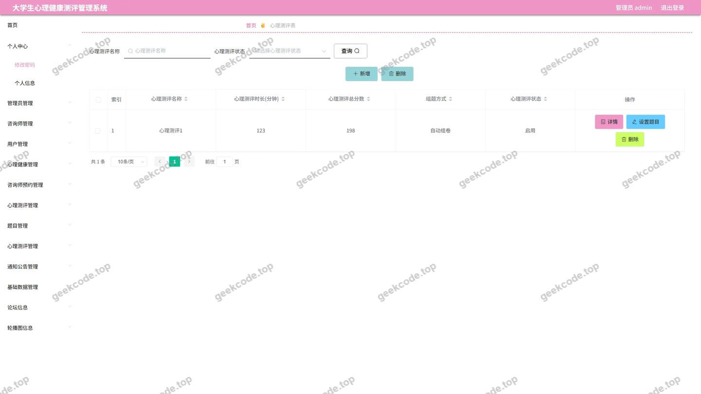</a>

<h4>后台-试卷选题</h4>

<a href="https://geekcode.top/archives/%E5%A4%A7%E5%AD%A6%E7%94%9F%E5%BF%83%E7%90%86%E5%81%A5%E5%BA%B7%E6%B5%8B%E8%AF%84%E7%AE%A1%E7%90%86%E7%B3%BB%E7%BB%9F%E5%B0%8F%E7%A8%8B%E5%BA%8Fpf?utm_source=github" title="查看完整源码">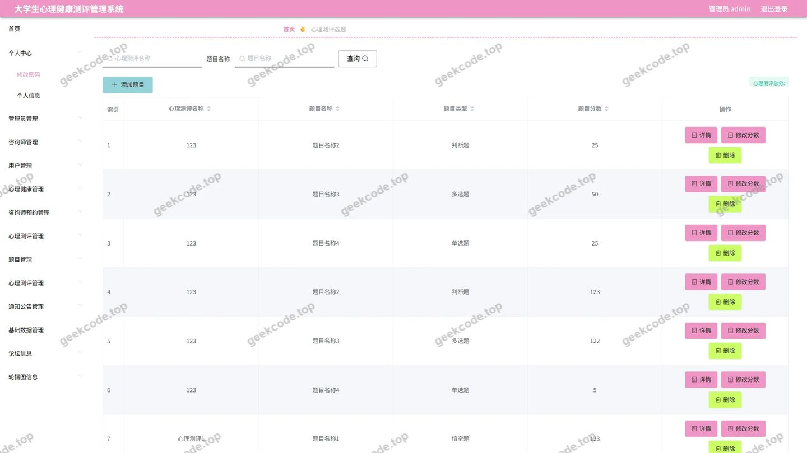</a>

<h4>后台-试题</h4>

<a href="https://geekcode.top/archives/%E5%A4%A7%E5%AD%A6%E7%94%9F%E5%BF%83%E7%90%86%E5%81%A5%E5%BA%B7%E6%B5%8B%E8%AF%84%E7%AE%A1%E7%90%86%E7%B3%BB%E7%BB%9F%E5%B0%8F%E7%A8%8B%E5%BA%8Fpf?utm_source=github" title="查看完整源码">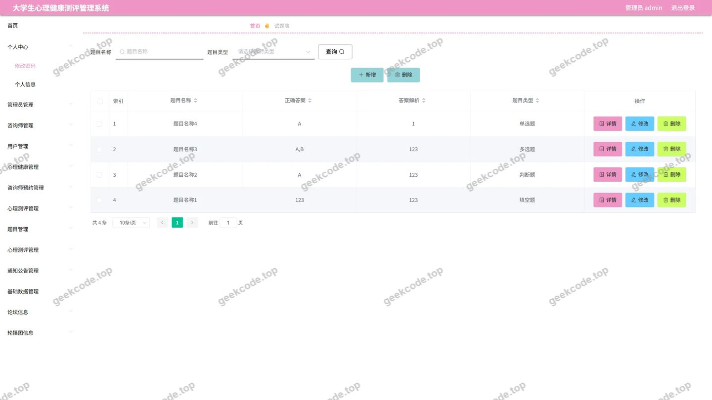</a>

<h4>后台首页</h4>

---

## 获取完整源码

| 项目 | 说明 |
| --- | --- |
| 项目名 | 大学生心理健康测评管理系统小程序pf |
| 运行截图 | 本文 25 张（站点带水印原图，仓库 `images/` 目录） |
| 完整源码 | [https://geekcode.top/archives/%E5%A4%A7%E5%AD%A6%E7%94%9F%E5%BF%83%E7%90%86%E5%81%A5%E5%BA%B7%E6%B5%8B%E8%AF%84%E7%AE%A1%E7%90%86%E7%B3%BB%E7%BB%9F%E5%B0%8F%E7%A8%8B%E5%BA%8Fpf?utm_source=github](https://geekcode.top/archives/%E5%A4%A7%E5%AD%A6%E7%94%9F%E5%BF%83%E7%90%86%E5%81%A5%E5%BA%B7%E6%B5%8B%E8%AF%84%E7%AE%A1%E7%90%86%E7%B3%BB%E7%BB%9F%E5%B0%8F%E7%A8%8B%E5%BA%8Fpf?utm_source=github) |
| 咨询微信 | **ir9372**（备注：jingpin-yuanma） |
| 更多项目 | [极客代码 geekcode.top](https://geekcode.top/?utm_source=github) |

> 需要源码、部署、改配置、跑不起来等问题，加微信 ir9372 沟通，说明项目名即可。
